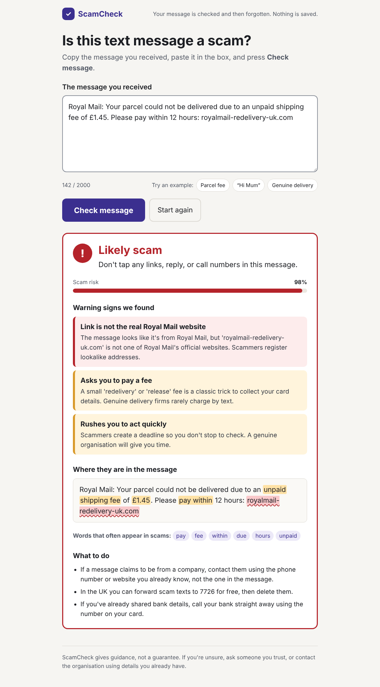
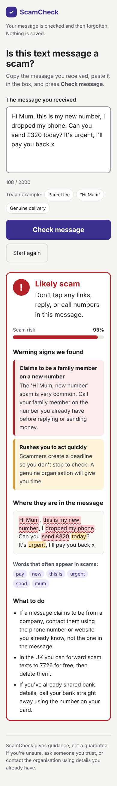

# ScamCheck


**Paste a text message and find out whether it's likely to be a scam, and why.**

Scam texts pretending to be from Royal Mail, banks, HMRC or a family member on a "new number" are now a daily problem, and older people are hit hardest. ScamCheck gives anyone a clear verdict, points to the exact warning signs in the message, and says what to do next. It's built for people who aren't confident with technology: large text, one box, one button.

<p align="center">
  
  
</p>

## How it works

Two layers look at every message, and either one can raise the alarm:

```
message ──┬──► ML model (TF-IDF + logistic regression) ──► "how scam-like is the wording?"  (probability)
          │                                                                                         │
          └──► warning-sign rules (signals.py) ──────────► "which known tricks does it use?" (reasons + spans)
                                                                                                    ▼
                                         risk = max(model, rules) ──► Likely scam / Be careful / No obvious warning signs
```

| Layer | What it's good at | Example |
|---|---|---|
| **Machine learning model** | Recognising scam *language*, even in wording it hasn't seen exactly | "Congratulations ur awarded a £500 voucher, txt CLAIM" |
| **Warning-sign rules** | Structural tricks that wording alone can miss, explained in plain English | A "Royal Mail" text whose link goes to `royalmail-redelivery-uk.com`, not `royalmail.com` |

The rules detect: lookalike or mismatched links, link shorteners, raw IP links, risky domain endings, requests to share a security code, "Hi Mum, new number", requests for card or bank details, small "redelivery" fees, numbers to call, premium-rate numbers, threats (account suspended, arrest), artificial urgency, prizes, refunds, guaranteed investments and fake job offers.

A link to the company's real website (e.g. `royalmail.com` in a Royal Mail text) counts as a *reassuring* sign, which stops genuine delivery and bank notifications from being flagged.

## Results

The model is trained on two datasets (see [`data/README.md`](data/README.md)):

1. **SMS Spam Collection** (UCI, 2012): 5,574 real labelled texts.
2. **Modern UK examples**: 177 hand-written texts covering scams that barely exist in the 2012 data (parcel fees, HMRC refunds, bank alerts, "Hi Mum"), plus genuine look-alike messages.

Held-out test results (`python -m scamcheck.train`), where *flagged* means the verdict is "Likely scam" or "Be careful":

| System | Test set | Precision | Recall | F1 | False alarms | Missed scams |
|---|---|---:|---:|---:|---:|---:|
| Naive Bayes (baseline) | UCI (1,115 msgs) | 0.993 | 0.906 | 0.947 | 1 | 14 |
| Logistic regression | UCI (1,115 msgs) | 0.993 | 0.953 | 0.973 | 1 | 7 |
| **Model + rules (what users get)** | UCI (1,115 msgs) | **0.993** | **0.953** | **0.973** | **1** | **7** |
| Naive Bayes (baseline) | Modern UK (54 msgs) | 0.789 | 0.750 | 0.769 | 4 | 5 |
| Logistic regression | Modern UK (54 msgs) | 0.905 | 0.950 | 0.927 | 2 | 1 |
| **Model + rules (what users get)** | Modern UK (54 msgs) | **0.909** | **1.000** | **0.952** | **2** | **0** |

The modern test set is small, so treat it as a sanity check rather than a precise score. The rule layer's main value is the explanation and catching cases like the one missed modern scam. CI fails if precision or recall drops below set minimums.

## Running it

### Option 1: Docker (everything in one command)

```bash
docker build -t scamcheck .
docker run -p 8000:8000 scamcheck
# open http://localhost:8000
```

The image builds the React app, trains the model, and runs as a non-root user.

### Option 2: Run locally (for development)

```bash
git clone https://github.com/isha0404/scamcheck.git && cd scamcheck

# Backend
python -m venv .venv && source .venv/bin/activate        # Windows: .venv\Scripts\activate
pip install -e ".[dev]"
python -m scamcheck.train                                # trains in a few seconds, prints the table above
uvicorn scamcheck.api:app --reload                       # API on http://localhost:8000 (docs at /docs)

# Frontend (in a second terminal)
cd frontend
npm install
npm run dev                                              # web app on http://localhost:5173
```

From the command line:

```bash
python -m scamcheck "Hi Mum, this is my new number, can you send £300 today?"
```

### Tests

```bash
pytest                       # 52 Python tests: rules, model quality, verdicts, API, security headers
cd frontend && npm test      # highlight logic
```

## API

`POST /api/check`

```json
{ "message": "Royal Mail: pay £1.45 at royalmail-redelivery-uk.com today" }
```

```json
{
  "verdict": "scam",
  "label": "Likely scam",
  "risk": 0.91,
  "model_probability": 0.91,
  "rule_score": 0.45,
  "signals": [
    { "id": "fake_link", "severity": "high", "title": "Link is not the real Royal Mail website",
      "detail": "The message looks like it's from Royal Mail, but 'royalmail-redelivery-uk.com' is not ...",
      "spans": [[25, 52]] }
  ],
  "model_terms": [{ "term": "pay", "weight": 0.46 }],
  "advice": ["..."]
}
```

`GET /api/health` returns the model's training date and test metrics. Interactive docs are at `/docs`.

## Design decisions

- **Logistic regression over a deep model.** It beats the Naive Bayes baseline, trains in seconds, and is *explainable*. Each word's contribution is `TF-IDF value × learned weight`, which is how the app shows "words that often appear in scams". For a tool whose job is to teach people what to look for, being able to explain matters more than a fraction of a percent of accuracy.
- **Word and character n-grams.** Word pairs capture phrases like "claim your prize". Character fragments cope with the misspellings and text-speak scammers use to dodge filters.
- **Separate evaluation on modern scams.** A model that scores 97% on 2012 spam can still miss today's parcel scams. Reporting the two sets separately makes that gap visible instead of hiding it in one number.
- **The verdict never says "safe".** The best case is "No obvious warning signs", because no tool can promise a message is safe.
- **Highlights use character positions, not HTML.** The API returns positions in the text, and React renders the text itself, so a message containing `<script>` is shown as harmless text.

## Security and privacy

- **Messages are never stored or logged.** They're analysed in memory and discarded. Messages are sent in the request body, which web server logs never record, and a test checks that message text doesn't appear in the application logs.
- **Input limits.** 2,000 characters maximum, validated by Pydantic, and a per-IP rate limit (30 checks a minute).
- **Security headers.** A strict Content-Security-Policy (no third-party scripts or fonts), `X-Frame-Options: DENY`, `nosniff`, `no-referrer`, and `no-store` on API responses.
- **CORS** allows only the local dev server by default.
- **Model files are pickles.** `joblib` files can run code when loaded, so ScamCheck only loads a model you trained yourself. The model isn't committed to the repo; it's rebuilt from the data.
- **Least privilege.** The Docker container runs as a non-root user.

## Limitations and next steps

- English only, and the rules are tuned for the UK (brands, 7726, 09 numbers).
- It can't see who *sent* the message. A text from a saved contact vs an unknown number would be a strong signal.
- It doesn't check whether a link is live or on a blocklist. A next step is a lookup against a URL reputation service such as Google Safe Browsing.
- The modern dataset is small and hand-written. More real-world examples (e.g. from people's reports to 7726) would make the modern score more reliable.

## Project layout

```
src/scamcheck/
  signals.py    warning-sign rules: links, brands, codes, urgency, ...
  model.py      TF-IDF + logistic regression, explanations, save/load
  train.py      training, baseline comparison, evaluation on both test sets
  checker.py    combines model + rules into a verdict
  api.py        FastAPI service, rate limiting, security headers
data/           UCI SMS Spam Collection + modern UK examples (with sources)
frontend/       React (Vite) web app
tests/          pytest suite, plus a JavaScript test for the highlighter
```

## Credits

SMS Spam Collection by Tiago A. Almeida and José María Gómez Hidalgo (CC BY 4.0). Scam patterns are based on public guidance from the NCSC and Action Fraud.

MIT © Isha Inani
